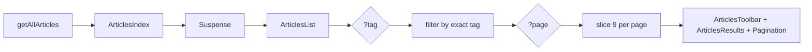
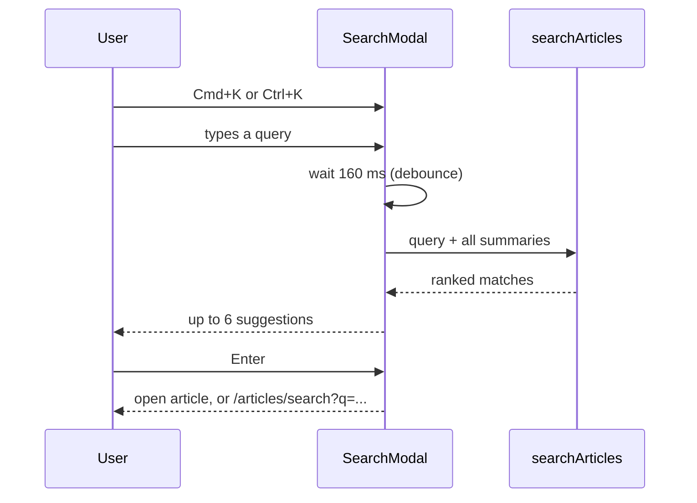

# Article listing and search

> **In short:** `/articles` is one static page. The top shows the latest series and a Filters button that opens the topics. Topic filter and pagination use query strings (`?tag=Git&page=2`) and run in the browser. Search also runs in the browser over titles, tags, and descriptions. No search index file is built.

## Files involved

All component paths are under `src/components/pages/articles/`.

| File                                | What it does                                       |
| ----------------------------------- | -------------------------------------------------- |
| `src/app/articles/page.tsx`         | Loads all articles, renders `ArticlesIndex`.       |
| `src/app/articles/search/page.tsx`  | The results page. Marked `noindex`.                |
| `ArticlesIndex.tsx`                 | Page layout. Wraps the list in `<Suspense>`.       |
| `common/PageTopBar.tsx`             | Breadcrumb row, hidden h1 and intro.               |
| `ArticlesBrowse/`                   | Latest series, Filters button and topic panel.     |
| `ArticlesList.tsx`                  | Reads `?tag` and `?page`, filters and slices.      |
| `Pagination.tsx`                    | Page links.                                        |
| `ArticleRowList.tsx`, `ArticleRow/` | The row list (the default layout).                 |
| `ArticleGrid.tsx`, `ArticleCard/`   | The card grid.                                     |
| `ArticlesToolbar.tsx`               | Count or "found for" line, plus the layout toggle. |
| `ArticlesViewToggle/`               | Grid/list toggle, saved choice, pre-paint script.  |
| `ArticlesResults.tsx`               | Shows a page as the grid or the rows.              |
| `ArticlesIndexFallback/`            | The pre-rendered first page (always the list).     |
| `ArticleSearch/`                    | Search box, `Cmd+K` modal, suggestions.            |
| `SearchResults/`                    | Results on `/articles/search?q=...`, Clear search. |
| `src/utils/topicCounts.ts`          | Topics with counts, busiest first.                 |
| `src/utils/searchArticles.ts`       | The scoring function.                              |
| `src/utils/pageHref.ts`             | Builds page links and keeps other query params.    |

## Listing

1. The route passes **every** article summary to the client.
2. `ArticlesList` reads `?tag=` and `?page=` with `useSearchParams`.
3. It filters by the exact tag, then shows 9 per page (`ARTICLES_PER_PAGE` in `posts.ts`).
4. A bad page number falls back to page 1.
5. `useSearchParams` needs a `<Suspense>` wrapper in a static export. The fallback (first page, no filter) is what ends up in the HTML, so crawlers and no JS visitors see page 1.

**The top of the page** (`PageTopBar`) is the breadcrumb with the search button beside it. The "Articles" h1 and the intro line are still in the HTML for screen readers and search engines, but hidden (`sr-only`), since the breadcrumb already names the page.

**The browse bar** (`ArticlesBrowse`, built on the shared `FilterBar`) is one line:

- **Latest series:** the most recently published or updated series as a pill that opens part 1, plus an "All series (N)" link to `/articles/series` (see [Series page](Series-Page.md)).
- **Filters:** a button that opens a panel with every topic and its article count, busiest first (`buildTopicCounts`). The selected topic is filled and links back to `/articles` to clear it. The panel starts open when the page loads with `?tag=`; while it is closed, a "Laravel ×" chip beside the button names the applied topic.

**Rows** show a date tile in the cover colours, category, reading time, series part, title, description, and tag links. **Cards** show the cover instead of the date tile.

## Grid or list

The toolbar above the results has a **List view** / **Grid view** toggle. **List** is the default: the compact `ArticleRow`s from the home page. **Grid** shows the cover cards.

- **The choice is saved in the browser** (`localStorage` key `articles-view`, see `articlesView.ts`). It stays across reloads, topic filters, pages, the search page, the series page, and other tabs.
- **No flash.** The static HTML is always the list, because the saved choice can only be read in the browser. `ArticlesViewScript` (in the root layout's `<head>`, next to the theme script) marks `<html data-articles-view="grid">` before first paint, and `ArticlesIndexFallback.module.css` keeps the pre-rendered list invisible for those visitors until their grid renders. Without JavaScript the mark is never set, so the list shows.

## Search

**Scoring** (`searchArticles.ts`). Every word must match somewhere:

| Match                   | Points |
| ----------------------- | ------ |
| Title equals query      | 100    |
| Title starts with query | 40     |
| Title contains a word   | 20     |
| Tag equals a word       | 30     |
| Tag contains a word     | 12     |
| Description contains    | 4      |

Ties go to the newest post. The article body is **not** searched.

**Modal.** Opens with `Cmd+K` (Mac) or `Ctrl+K`. Arrow keys move, Enter opens, Escape closes. Focus is trapped inside while open. Matched words are wrapped in `<mark>`.

**Results page.** `/articles/search?q=...&page=2` has the same top bar as `/articles`, with the search button pre-filled with the query (`QueryArticleSearch`). It shows three states: empty, no match, or results. Results use the same toolbar ("3 articles found for ...", then a "Clear search ×" chip back to `/articles`) and follow the saved list/grid choice. Series labels count every article, not just the matches.

## Good to know

- **Search works only where `ArticleSearch` is mounted**: `/articles` and `/articles/search`.
- **Big article counts** mean a bigger page, since all summaries ship in the HTML payload.
- `getArticlesForPage` and `getArticlePageCount` in `posts.ts` are not used anywhere.

## Related pages

- [Articles overview](Articles-Overview.md)
- [Series page](Series-Page.md)
- [Article page](Article-Page.md)
