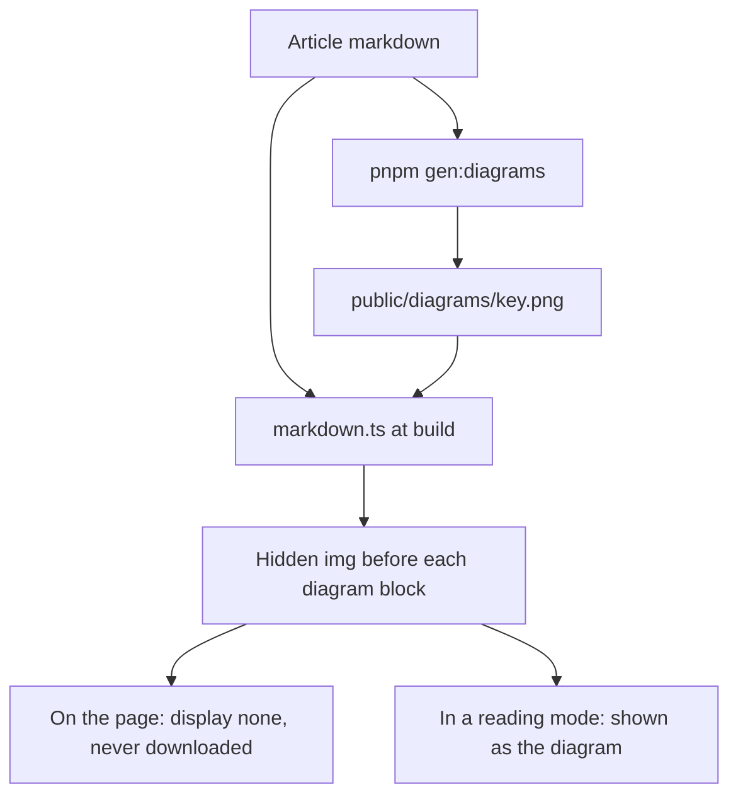

# Reading mode

> **In short:** Browser reading modes (Chrome Reading mode, Firefox Reader View, Edge, Safari Reader) rebuild an article from its markup. The article page gives them a byline, keeps the extras out of their way, and ships a hidden picture of every diagram, because they throw the live diagram away.

## Files involved

| File                                                                     | What it does                                                             |
| ------------------------------------------------------------------------ | ------------------------------------------------------------------------ |
| `src/components/pages/articles/ArticleMeta.tsx`                          | "By Shibbir Ahmed" byline, a link with `rel="author"`.                   |
| `src/components/pages/articles/ArticleView/index.tsx`                    | Puts sharing, the pager and comments in the article's `<footer>`.        |
| `src/lib/diagramImages.ts`                                               | Diagram image keys, alt text, and the hidden `` tag.                |
| `src/lib/markdown.ts`                                                    | Puts that `` right before each `mermaid` and `reactflow` block.     |
| `scripts/generate-diagram-images.ts`                                     | `pnpm gen:diagrams`: draws every article diagram to a PNG.               |
| `public/diagrams/<key>.png`                                              | The drawn PNGs. Committed to git.                                        |
| `src/components/pages/articles/diagramFallbackImage.ts`                  | The `diagram-fallback-image` class name.                                 |
| `src/components/pages/articles/ArticleContent/ArticleContent.module.css` | Hides those images on the page with `display: none`.                     |
| `next.config.ts`                                                         | `globPublicPatterns` keeps `public/diagrams/` out of the service worker. |

## How it works

1. Most reading modes run Mozilla's **Readability** library over the page. Chrome runs it on a copy of the live page with no styles applied.
2. Readability drops an element hidden by an inline style, the `hidden` attribute or `aria-hidden="true"`, **unless its class contains `fallback-image`** (an exception made for Wikipedia's math images). It never reads stylesheets.
3. So each diagram gets ``, hidden by a stylesheet rule only. Screen readers skip it (they get the live diagram), the page never shows it, and a lazy image that is `display: none` is never fetched.
4. A reading mode keeps the image and loads it, so the reader sees the diagram as a picture.
5. The image is named by a hash of the diagram source, the light Mermaid theme and a render version. A changed diagram gets a new name, so an old picture can never show for it.
6. A `reactflow` block is drawn as its first scenario, the one the page opens on. The alt text is "Diagram: " plus the `title:` (or the scenario name). A `mermaid` block uses its `accTitle:` line.

Other small fixes for reading modes:

- Decorative icons (check marks, chevrons) are `aria-hidden`, or reading modes draw them full width.
- The flow diagram hint ("Press Interactive...") is `aria-hidden`, since its buttons are gone in a reading mode. Screen readers still hear it through the figure's `aria-describedby`.
- Flow captions have a visually hidden ": " so "Step 2" and its text do not run together.

## How to change it

- **Added or edited a diagram?** Run `pnpm gen:diagrams` and commit the new PNGs. It also deletes PNGs no article uses.
- **Changed the Mermaid theme or how images are drawn?** Bump `RENDER_VERSION` in `diagramImages.ts` (theme changes already change every key), then run `pnpm gen:diagrams --force`.
- **See what a reader gets:** in Chrome, right-click the page and pick "Open in reading mode". In Firefox, press the reader icon in the address bar.

## Good to know

- **Not part of `pnpm build`.** Drawing Mermaid needs a real browser (it measures text), and the deploy job has none. A missing PNG just means no `` is written, so the page never points at a 404.
- **The content test catches a forgotten run.** `tests/content/diagramImages.test.ts` fails when a diagram has no PNG, or a PNG is left over.
- **Keep `fallback-image` in the class name.** Without it Readability drops the image.
- **Hide it with CSS only.** An inline `style` or the `hidden` attribute would make Readability drop it too.
- **Chrome's address bar icon is not ours to show.** Chrome asks a Google server whether a page is "reader mode eligible" before it shows the icon. The markup passes Chrome's own Readability check, and the menu entry always works.
- **Safari Reader is untested.** It may honour the stylesheet and skip the images.
- **Fonts.** The generator draws with the bundled Noto Sans (`scripts/assets/fonts`), the site's body font. Mermaid sizes boxes with the body font, so any other font gives cramped labels.

## Related pages

- [Article page](Article-Page.md)
- [Mermaid diagrams](Mermaid-Diagrams.md)
- [Flow diagrams](Flow-Diagrams.md)
- [PWA and offline](PWA-and-Offline.md)
