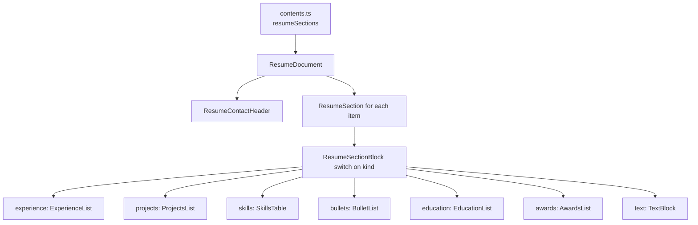

# Resume page

> **In short:** `/resume` is an HTML resume built from `src/app/resume/contents.ts`. The "Download PDF" button calls `window.print()`. In print the page swaps the framed screen card for a second layout, `ResumePrint`: a classic one-column black and white CV, built from the same data.

## Files involved

| File                                                 | What it does                                                |
| ---------------------------------------------------- | ----------------------------------------------------------- |
| `src/app/resume/page.tsx`                            | The route: metadata, breadcrumb, button, document, JSON-LD. |
| `src/app/resume/contents.ts`                         | All resume data: name, location, contacts, sections.        |
| `src/components/pages/resume/types.ts`               | Types for every section kind.                               |
| `src/components/pages/resume/ResumeDocument.tsx`     | The screen card that holds the whole resume.                |
| `src/components/pages/resume/ResumeSectionBlock.tsx` | Picks the right screen body for each section `kind`.        |
| `src/components/pages/resume/ResumePrint/`           | The printed CV layout and its parts (`Print*` components).  |
| `ResumePrint/PrintSectionBlock.tsx`                  | Picks the right printed body for each section `kind`.       |
| `src/components/pages/resume/DownloadPdfButton.tsx`  | Calls `window.print()`.                                     |
| `src/utils/resumeJsonLd.ts`                          | `ProfilePage` JSON-LD for the resume.                       |
| `src/lib/resume.ts`, `scripts/prepare-resume.ts`     | Old static PDF helpers (see "Good to know").                |

## How it works

1. `resumeSections` is an ordered list. The array order is the page order.
2. Each section has a `kind`. `ResumeSectionBlock` picks the matching list component.
3. The card uses the accent bloom and cursor spotlight on screen, with a neutral accent.

## Print and PDF

- The button runs `window.print()`. The visitor saves it as PDF from the print dialog.
- The page renders two layouts from the same data. The screen card sits in a `print:hidden` wrapper (`data-testid="resume-screen"`). `ResumePrint` is `hidden print:block` (`data-testid="resume-print"`).
- The printed CV fits one A4 page. `ResumePrint.module.css` sets `@page { size: A4; margin: 11mm 13mm }`, so every print dialog lays it out the same way. A Playwright test fails if it spills onto a second page, so trim content (or tighten the print type) when adding to the resume.
- The printed CV: name on the left, the `resumeHeadline`, location, contact links and languages, a dark rule, then dark uppercase section headings over grey hairlines. Accents are near-black (`neutral-900`), with grey for secondary lines.
- Each job reads "Role, Company" with the dates on the right, then a line with the location and "Promoted from ..." (`experienceSubline.ts`, shared by the page and the PDF), the bullets, and an optional tech line. The page and the PDF show the same text and order.
- A `projects` section with `layout: 'compact'` prints one bullet per project (name, stack, description). Without it, each project gets a heading and bullets.
- The screen components carry no `print:` styles. All print styling lives in `ResumePrint/`, using Tailwind `print:` variants. There is no `@media print` in `globals.css`.
- The navbar, footer, breadcrumb, and button are hidden in print.
- Print is always a white page, even in dark mode with "Background graphics" on: `layout.tsx` gives `<html>` `print:scheme-light! print:bg-white!` and `<body>` `print:bg-white!`. The `!` beats the inline `color-scheme` the theme switcher sets on `<html>`.

## How to change it

- **Edit content:** change `src/app/resume/contents.ts`.
- **Change the headline or languages:** edit `resumeHeadline` or `resumeLanguages` in `contents.ts`. Both show under the name on the page and in the PDF.
- **Summary paragraphs:** a `text` section holds `paragraphs: string[]`, one entry per paragraph.
- **Explain a role:** set `context` on a position (e.g. the product) and it leads the line under the role, before the location.
- **Add a new section layout:** add a `kind` to the union in `types.ts`, then a `case` and a body component on both sides: `ResumeSectionBlock.tsx` (screen) and `ResumePrint/PrintSectionBlock.tsx` (print).
- **Preview the PDF:** click "Download PDF" and look at the print preview, or turn on print media emulation in the browser dev tools.

## Good to know

- **The resume name is separate** (`resumeName` in `contents.ts`) from `siteName`.
- **Old PDF flow.** `gen:resume` still copies a real PDF from `content/resume/` to `public/resume-shibbir-ahmed.pdf`, but nothing links to it now. Real PDFs in `content/resume/` are git ignored. Only the `.example.pdf` placeholder is committed.
- **JSON-LD** is a `ProfilePage` whose `Person` shares the `#person` id with the home page. Production only.
- OG image: `resumeThumbnail` from `constants.ts`.

## Related pages

- [Now and uses pages](Now-and-Uses-Pages.md)
- [SEO and structured data](SEO-and-Structured-Data.md)
