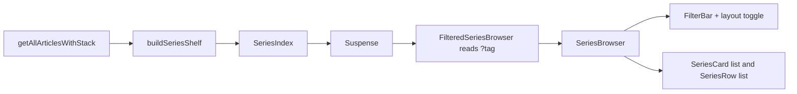

# Series page

> **In short:** `/articles/series` lists every multi-part series, newest first, as rows (the default) or cards. A Filters button opens the topics. Each series shows its parts in order, its topics and tech stack, and a "Start with part 1" button. The articles page links here with "All series".

## Files involved

All component paths are under `src/components/pages/articles/`.

| File                                | What it does                                                       |
| ----------------------------------- | ------------------------------------------------------------------ |
| `src/app/articles/series/page.tsx`  | Builds the series list and renders `SeriesIndex`.                  |
| `src/utils/seriesShelf.ts`          | `buildSeriesShelf`: groups articles into series with their totals. |
| `src/lib/posts.ts`                  | `getAllArticlesWithStack`: summaries plus the frontmatter `tech`.  |
| `SeriesIndex/index.tsx`             | Page layout: `PageTopBar`, then the browser inside `<Suspense>`.   |
| `SeriesIndex/FilteredSeriesBrowser` | Reads `?tag=` in the browser.                                      |
| `SeriesIndex/SeriesBrowser.tsx`     | Count, Filters, layout toggle, then cards and rows.                |
| `SeriesIndex/SeriesCard/`           | Grid card: cover deck, meta, parts, topics, stack, start button.   |
| `SeriesIndex/SeriesRow/`            | List row: the same pieces side by side.                            |
| `SeriesIndex/SeriesCoverStack/`     | The part covers stacked like a deck (up to 3).                     |
| `ArticlesBrowse/FilterBar.tsx`      | The Filters button and topic panel, shared with `/articles`.       |

## How it works

1. `buildSeriesShelf` groups published articles by `series.name`, puts the parts in `series.order`, adds up the reading time, and takes the first part's cover colours as the accent.
2. **Newest first:** a series is dated by its newest part's `updated` (or `date`).
3. **Topics:** every part's tags, the ones more parts share first. **Stack:** every part's `tech`, in reading order without repeats.
4. **Filtering:** `?tag=` keeps every series that has a part with that tag. Topic counts on this page count series, not articles. Tag links on the cards filter this page (`/articles/series?tag=...`).
5. **Layouts:** both the cards and the rows ship in the HTML. `SeriesIndex.module.css` shows one from the `data-articles-view` mark on `<html>` (the same pre-paint script and saved choice as `/articles`, see [Article listing and search](Article-Listing-and-Search.md)), so nothing flashes and no script is needed to lay it out.
6. **The latest series** (the first entry) is also shown on `/articles` beside the "All series" link.

## How to change it

- **Start a series:** give each article the same `series.name` and its `series.order` in the frontmatter (see [Article markdown](Article-Markdown.md)).
- **Show a stack:** list the tools in each part's `tech` frontmatter.
- **Change the deck:** `STACKED_COVER_LIMIT` and the offsets in `SeriesCoverStack.module.css`.

## Good to know

- The page is in the sitemap only when at least one series exists.
- The h1 ("Series") and intro are kept for screen readers and search engines but hidden, like the other section pages (`PageTopBar`).
- A one-part series still gets a card here, though the in-article tracker needs two parts (`getSeriesForArticle`).

## Related pages

- [Article listing and search](Article-Listing-and-Search.md)
- [Article page](Article-Page.md)
- [Articles overview](Articles-Overview.md)
